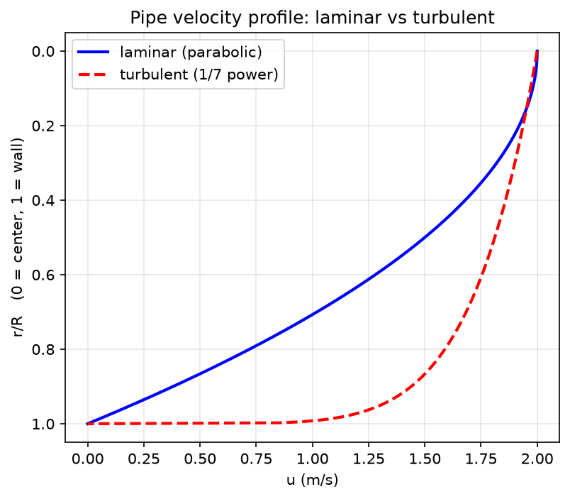

# 第 02 讲：流体流动基础

> **前置**：第 01 讲 ｜ **预计时间**：3 小时（含作业）
>
> **一句话定位**：这一讲给你判断"物料到底往哪个方向流、这段管线合不合理"的**物理根据**——把第 01 讲里"泵出口朝哪走"这种"看着像"的推测，升级成"算得出"。
>
> **本讲回答什么**：
> 1. 管子里的流速、流量、管径之间是什么关系？（连续性方程）
> 2. 流体为什么这样流、往哪流？谁在推动它？（伯努利方程 = 流体的能量守恒）
> 3. 怎么判断管内是"平稳层流"还是"混乱湍流"？（雷诺数）
> 4. 流体流过管子会"损失"掉什么？怎么估？（沿程阻力 + 局部阻力）
> 5. 这些怎么变成逆向作业里的软约束？
>
> **这一讲有真实验证**：连续性（管径减半→流速×4，实测比值 4.000）、雷诺数分档（500/2500/100000）、层流平均流速=最大流速一半（实测 1.0000）、Torricelli 出流（14.0071 m/s）、Colebrook 摩擦系数（λ=0.02183）+ Darcy 沿程损失（8.902 m）。脚本 `scripts/lec02-01_verify_flow_bernoulli.py`。
>
> **本讲目标（学完你能）**：
> - 能用连续性方程由流量和管径算流速。
> - 能写出伯努利方程、说清每一项的物理含义，并**据此判断两点之间流体的流向**。
> - 能用雷诺数判断层流/湍流。
> - 能说出"三通/旁路/变径"在逆向作业里意味着什么。
>
> 目标达成 = 末尾"掌握度自测"全打勾。

## 本讲怎么走（脉络图）

```
成品开场（判断一段管线合不合理：能算）
   ↓
连续性方程 —— 管细了流速就快                        [推]
   ↓
伯努利方程 —— 流体的能量守恒，流向的物理根据          [推]（破误会 M1）
   ↓
雷诺数与流型 —— 层流 or 湍流                        [直]
   ↓
阻力损失 —— 沿程(Colebrook/Darcy) + 局部(三通/弯头)  [用/知]
   ↓
这些怎么变成逆向作业的软约束                         [用]
   ↓
小结 → 自测 → 作业
```

---

## 一、成品开场：判断一段管线合不合理

第 01 讲你建了一张图：`T-101 → P-101 → E-101`。但你其实还没本事回答一个关键问题——**这根管子里的东西，真的是从 T-101 流向 P-101 吗？会不会反过来？** 光看走向是猜，这一讲让你能**算**。

学完这一讲，你能对任意两点 1、2 之间的一段管，回答三件事：

1. **流速多大**：知道流量和管径，用连续性方程算流速（例：管径从 0.10 m 缩到 0.05 m，流速从 1.27 m/s 猛增到 5.09 m/s）。
2. **往哪流**：比较两点的"总机械能"，流体**从总能量高的一端流向低的一端**（伯努利）。
3. **要损失多少**：流体流过 100 m 管子，因为摩擦要"亏掉" 8.9 m 的压头（Darcy 公式）——这决定了没有泵它能不能自己流过去。

这三件事，就是后面判断"这段连接合不合理"的物理尺子。下面一件件拆。

---

## 二、连续性方程：管子细了，流速就快

**理解层次：推（要能手算）**

### 2.1 它说什么

**连续性方程**（continuity equation）说人话就是：**流体不可压缩、又不产生不消失时，单位时间流进一段管子的体积 = 流出的体积。** 想象水管里塞满水，你从一头匀速灌，另一头必须匀速出同样多——中间不会凭空多也不会凭空少。

写成公式，用**体积流量** $Q$（每秒流过多少立方米，单位 m³/s）：

$$Q = A_1 v_1 = A_2 v_2$$

- $A$：管子横截面积（m²）。圆管 $A = \dfrac{\pi}{4} d^2$，$d$ 是管内径。
- $v$：该截面上的**平均流速**（m/s）。
- 下标 1、2 指管子的两个不同截面。

### 2.2 手算一遍（成品开场那个数的来历）

已知 $Q = 0.01$ m³/s，管径从 $d_1 = 0.10$ m 缩到 $d_2 = 0.05$ m，求两段流速。

$$A_1 = \frac{\pi}{4}(0.10)^2 = 0.00785 \text{ m}^2,\quad v_1 = \frac{Q}{A_1} = \frac{0.01}{0.00785} = 1.273 \text{ m/s}$$

$$A_2 = \frac{\pi}{4}(0.05)^2 = 0.00196 \text{ m}^2,\quad v_2 = \frac{Q}{A_2} = \frac{0.01}{0.00196} = 5.093 \text{ m/s}$$

**实测**（脚本 EXP1）：$v_1=1.2732$、$v_2=5.0930$，比值 $v_2/v_1 = 4.000$。

**规律记住这一条**：管径减半 → 截面积变 1/4 → 流速变 4 倍。即 $v_2/v_1 = (d_1/d_2)^2$。

### 2.3 逆向作业里它意味着什么

现场看到**管径突然变化**，不是随便的：

- **变径**（管突然变细/变粗）：流速随之突变。泵入口管常比出口管**粗**（让流速慢一点，防止后面要讲的"气蚀"，第 03 讲）。
- 如果你逆向时看到"粗管接细管再接粗管"，中间那段细管往往是**调节阀/孔板/流量计**所在位置（第 04 讲）——它们是故意制造流速/压差变化的元件。

---

## 三、伯努利方程：流体的能量守恒，流向的物理根据

**理解层次：推（要能手算、要能判流向）**

### 3.1 先说"压头"这个词（不空降）

化工里算流体能量，习惯不用"焦耳"，而用**压头**（head）——**把能量换算成"能把流体举多高"的米数**（单位 m）。为什么用米？因为直观：说"这点有 10 m 压头"，就是"这股能量能把水柱顶到 10 m 高"。

流体在任一点的总机械能（以米计）由三块组成：

| 项 | 名字 | 公式 | 说人话 |
|---|---|---|---|
| $z$ | 位头（位压头） | $z$ | 这一点离基准面多高——**位置高度**带来的能量 |
| $\dfrac{p}{\rho g}$ | 压头（静压头） | $\dfrac{p}{\rho g}$ | 这一点流体**压力** $p$ 能顶多高；$\rho$=密度(kg/m³)，$g$=9.81 m/s² |
| $\dfrac{v^2}{2g}$ | 速度头（动压头） | $\dfrac{v^2}{2g}$ | 这一点流体**流速** $v$ 带的动能换算成高度 |

> **压力 $p$ 用哪种？** 有**绝对压**（从真空 0 算起）和**表压**（gauge pressure = 绝对压 − 大气压，即压力表的读数）两种。伯努利方程里两点**都用绝对压、或都用表压**都行，只要统一；两点都用表压时大气压自动抵消，最省事（本讲作业 B 就用表压）。

### 3.2 理想伯努利方程

对**不可压缩、无摩擦、稳态**流动的流体，沿同一条流线，总压头守恒：

$$z_1 + \frac{p_1}{\rho g} + \frac{v_1^2}{2g} = z_2 + \frac{p_2}{\rho g} + \frac{v_2^2}{2g}$$

说人话：**位置高、压力大、流速快，这三种能量可以互相转换，但总量不变。** 管子细了流速快（速度头大），那压力就得降（压头小）——这就是"流速大的地方压力小"，喷雾器、飞机机翼都是这个理。

### 3.3 用它判断流向（本讲最关键的技能）

**流体自发地从"总压头高"的地方流向"总压头低"的地方。** 比较两点的 $z + \dfrac{p}{\rho g} + \dfrac{v^2}{2g}$，谁大谁就是上游。

> **打破常见误会（M1，再夯实一次）**：判断流向**不是看谁离得近、谁在下面**，而是比总压头。一根管从低处往高处流完全可能（只要低端压力够大，比如泵在后面顶着）。所以逆向作业时"这根管朝楼下走所以是往下流"这种直觉**不可靠**，得看压力/泵。

### 3.4 手算：水塔出流速度（Torricelli）

一个敞口水塔，液面比出口高 $h = 10$ m，两端都通大气。求出口流速。

取点 1 = 液面，点 2 = 出口：
- $p_1 = p_2 = $ 大气压 → 压头项抵消；
- 液面很大、下降极慢，$v_1 \approx 0$；
- $z_1 - z_2 = h = 10$ m。

代入伯努利：$z_1 = z_2 + \dfrac{v_2^2}{2g}$，得

$$v_2 = \sqrt{2gh} = \sqrt{2 \times 9.81 \times 10} = 14.007 \text{ m/s}$$

**实测**（脚本 EXP4）：`14.0071 m/s`。这就是著名的 **Torricelli 定律**——水从 10 m 高的洞口喷出，速度等于水自由落体 10 m 后的速度（不是巧合，本质就是能量守恒）。

### 3.5 实际伯努利方程：加上泵和摩擦

理想方程假设"无摩擦、没有泵"。真实管路里有两件事要补：

$$z_1 + \frac{p_1}{\rho g} + \frac{v_1^2}{2g} + H_e = z_2 + \frac{p_2}{\rho g} + \frac{v_2^2}{2g} + h_f$$

- $H_e$：**泵对流体做的功**，换算成压头（m），叫泵的**扬程**。泵是"给流体充能量"的，所以加在左边（上游侧）。第 03 讲整讲都在讲它。
- $h_f$：**摩擦阻力损失**（m）。流体流过管子会因摩擦"亏掉"能量，所以加在右边（下游侧）。下面第五节讲怎么算。

有了这两项，伯努利就能算真实管路了：**泵提供多少压头，要正好够"把流体提升 + 顶过压力差 + 补掉摩擦损失"。** 这也是第 03 讲"工作点"的本质。

---

## 四、雷诺数与流型：层流还是湍流

**理解层次：直（建立直觉）+ 会算 Re**

### 4.1 两种流态

管子里的流体有两种截然不同的流动状态：

- **层流**（laminar）：流体一层层平行滑动，互不掺混，平稳。像挤牙膏。
- **湍流**（turbulent）：流体剧烈翻腾、漩涡掺混，混乱。像瀑布。

流态影响阻力、传热、混合效率——所以要知道现在是哪种。

### 4.2 雷诺数：一个数判流态

用一个无量纲数**雷诺数** $Re$（Reynolds number）判断，它是"惯性力/粘性力"之比：

$$Re = \frac{\rho v d}{\mu}$$

- $\rho$：密度（kg/m³）；$v$：平均流速（m/s）；$d$：管内径（m）；$\mu$：**粘度**（Pa·s，读 miu，衡量流体"稠不稠、 resisting 流动"的程度，水约 $1\times10^{-3}$）。

判据（圆管）：

| $Re$ | 流态 |
|---|---|
| < 2300 | 层流 |
| 2300 ~ 4000 | 过渡区（不稳定） |
| > 4000 | 湍流 |

**实测**（脚本 EXP2，水 $\rho=1000$、$\mu=10^{-3}$、$d=0.05$ m）：

| $v$ (m/s) | $Re$ | 流态 |
|---|---|---|
| 0.01 | 500 | 层流 |
| 0.05 | 2500 | 过渡 |
| 2.0 | 100000 | 湍流 |

直觉：**流速越快、管越粗、流体越稀（粘度小），越容易湍流。** 工业管路里绝大多数是湍流。

### 4.3 速度分布：层流尖、湍流平

管截面上流速并不均匀——管壁处因摩擦为 0，中心最快。层流和湍流的"快慢分布形状"不同：



- **层流**：抛物线分布，$u(r) = u_{max}\left(1 - \dfrac{r^2}{R^2}\right)$，中心最快、壁面为 0。此时**平均流速 = 最大流速的一半**：$\bar{u} = u_{max}/2$。
- **湍流**：因强烈掺混，分布"扁平"得多，中心区和平均流速更接近（工程常用 $1/7$ 次幂近似）。

**实测**（脚本 EXP3，数值积分面积加权）：层流 $\bar{u} = 1.0000$，而 $u_{max}/2 = 2.0/2 = 1.0000$——**吻合**。这个"平均=最大一半"是层流特有的，湍流不是。

---

## 五、阻力损失：沿程 + 局部

**理解层次：用（会估沿程）+ 知（局部阻力认识即可）**

流体流过管路"亏掉"的压头 $h_f$ 分两块：

### 5.1 沿程阻力（直管摩擦）

流体在**直管**里因摩擦损失，用 **Darcy（达西）公式**：

$$h_f = \lambda \frac{L}{d} \frac{v^2}{2g}$$

- $L$：管长（m）；$d$：管内径（m）；$v$：流速；$\lambda$：**摩擦系数**（无量纲，读 lambda）。
- 直觉：**管越长、越细、流速越快，损失越大。**

$\lambda$ 取决于 $Re$ 和管壁**相对粗糙度** $\varepsilon/d$（$\varepsilon$=管壁凹凸的绝对粗糙度，商用钢管约 0.045 mm）。湍流时用 **Colebrook 方程**（隐式，要迭代解）：

$$\frac{1}{\sqrt{\lambda}} = -2\log_{10}\left(\frac{\varepsilon/d}{3.7} + \frac{2.51}{Re\sqrt{\lambda}}\right)$$

> Colebrook 是隐式方程（$\lambda$ 两边都出现），手解要迭代；工程上常查 **Moody 图**（一张 $\lambda$ 对 $Re$、参量 $\varepsilon/d$ 的图）直接读。**理解层次：知道有这回事 + 会查 Moody 图即可，不必背 Colebrook。** 脚本用 `scipy.optimize.fsolve` 数值解它。

**实测**（脚本 EXP5，$Re=10^5$、$\varepsilon/d=9\times10^{-4}$、$L=100$ m、$d=0.05$ m、$v=2$ m/s）：$\lambda = 0.02183$，$h_f = 8.902$ m。即流体流过这 100 m 管要亏掉约 8.9 m 压头——**没有泵顶着，它流不了这么远。**

### 5.2 局部阻力（管件）

流体经过**弯头、三通、变径、阀门**等管件时，因流向突变/涡流额外损失：

$$h_f' = \zeta \frac{v^2}{2g}$$

$\zeta$（读 zeta）是**局部阻力系数**，每种管件一个经验值（查手册）。**理解层次：认识即可。**

> **逆向作业直接相关**：**三通**（tee，一根管分成两支或两支汇一支的接头）是现场最常见的"分叉点"。你逆向时看到三通，就意味着**这里可能有旁路（bypass）或分流**——一股物料在这里分成两条路。第 01 讲作业里"泵出口是去 E-101 还是走旁路"这种分叉，物理上就发生在三通处。认出三通 = 找到图里一个"一度变两度"的节点。

---

## 六、这些怎么变成逆向作业的软约束

把这一讲的物理，翻译成能写进约束图/求解器的规则（软约束：一般成立，但教学模型/假管可能违反，第 11 讲会讲怎么用）：

1. **流向由总压头决定，不由高低/远近决定**（M1）。看到一根管，别急着按"水往低处流"定方向；先看有没有泵、两端压力。
2. **没有泵/压差，流体不会自己爬长距离**：沿程损失会吃掉压头（100 m 管亏 8.9 m）。所以一段"看起来凭空连通、却没有泵也没有高位槽压着"的长管，工艺上可疑。
3. **管径变化提示元件**：变径处常有阀/流量计；泵入口常比出口粗。
4. **三通 = 分叉节点**：见到三通就在图里标一个"可能旁路"的候选，让求解器去判断这股分去哪。

这些让第 01 讲那张"只有置信度、没有物理"的图，第一次**带上了工艺约束**——不再只是连线，而是"这样连物理上说得通吗"。

---

## 本讲小结

- **连续性方程** $Q = A_1 v_1 = A_2 v_2$：管径减半 → 流速×4（实测比值 4.000）。变径处常有阀/流量计。
- **压头**：把流体能量换算成"能举多高的米数"，分位头 $z$、压头 $p/\rho g$、速度头 $v^2/2g$。
- **伯努利方程**：总压头守恒；**流体从总压头高处流向低处**（判流向的尺子，破除 M1）。理想式无泵无摩擦；实际式加泵扬程 $H_e$、减摩擦损失 $h_f$。Torricelli 出流 $v=\sqrt{2gh}$（10 m → 14.007 m/s，实测）。
- **雷诺数** $Re=\rho v d/\mu$：<2300 层流、>4000 湍流。层流速度呈抛物线、平均=最大一半（实测 1.0000）；湍流扁平。
- **阻力损失**：沿程 Darcy $h_f=\lambda\frac{L}{d}\frac{v^2}{2g}$（λ 由 Colebrook/Moody，实测 λ=0.0218、hf=8.90 m）；局部 $\zeta\frac{v^2}{2g}$（弯头/三通/变径）。三通=分叉/旁路节点。

## 掌握度自测

- [ ] 我能由流量和管径算流速，并说出"管径减半流速变几倍"。
- [ ] 我能写出伯努利方程（含泵和摩擦项），逐项说清位头/压头/速度头是什么。
- [ ] 我能用总压头高低判断两点间流向，并举一个"流体从低处往高处流"的例子。
- [ ] 我能算雷诺数并判层流/湍流，说出层流平均流速与最大流速的关系。
- [ ] 我能说出三通在逆向图里对应什么结构（分叉/旁路）。

## 作业

**A.（数值题·连续性 + Torricelli）** 报告里要核对一股出流。某敞口罐液面比底部出口高 $h=5$ m，出口管内径 $d=0.04$ m。求：① 理想出口流速；② 该流速下的体积流量 $Q$（m³/s）；③ 若上游管径是 $0.08$ m，上游流速是多少？

<details><summary>参考答案</summary>

① $v=\sqrt{2gh}=\sqrt{2\times9.81\times5}=\sqrt{98.1}=9.905$ m/s。

② $A=\dfrac{\pi}{4}d^2=\dfrac{\pi}{4}(0.04)^2=1.257\times10^{-3}$ m²；$Q=Av=1.257\times10^{-3}\times9.905=0.01245$ m³/s。

③ 上游 $d_1=0.08$ m，$A_1=\dfrac{\pi}{4}(0.08)^2=5.027\times10^{-3}$ m²；$v_1=Q/A_1=0.01245/5.027\times10^{-3}=2.476$ m/s。（也可直接用 $v_1=v_2(d_2/d_1)^2=9.905\times(0.04/0.08)^2=9.905/4=2.476$ m/s。）

判据：①≈9.90 m/s、②≈0.0125 m³/s、③≈2.48 m/s；③ 应正好是 ① 的 1/4。
</details>

**B.（概念题·判流向）** 现场测得管上两点：点 1 在 $z_1=2$ m、表压 $p_1=200$ kPa、流速 $v_1=1$ m/s；点 2 在 $z_2=8$ m、表压 $p_2=50$ kPa、流速 $v_2=1$ m/s（$\rho=1000$ kg/m³）。问流体从哪点流向哪点？（提示：比总压头，$g=9.81$）

<details><summary>参考答案</summary>

算总压头 $z+\dfrac{p}{\rho g}+\dfrac{v^2}{2g}$（表压即可，两点都用表压，大气压抵消）：

点 1：$2 + \dfrac{200000}{1000\times9.81} + \dfrac{1^2}{2\times9.81} = 2 + 20.39 + 0.051 = 22.44$ m。

点 2：$8 + \dfrac{50000}{1000\times9.81} + 0.051 = 8 + 5.10 + 0.051 = 13.15$ m。

点 1 总压头（22.44 m）> 点 2（13.15 m），所以**流体从点 1 流向点 2**——尽管点 2 位置更高（$z_2=8>z_1=2$）。这正是破除 M1 的例子：位置高不代表是上游，点 1 的高压力把它顶上去了。

判据：算出两点总压头、比较、得出"1→2"，并指出"虽然 2 更高"。
</details>

**C.（代码题·雷诺数）** 写一段 Python：给定 $\rho=1000$、$\mu=1\times10^{-3}$、$d=0.05$，对流速列表 `[0.01, 0.1, 0.5, 1.0, 3.0]` 逐个算 $Re$ 并打印流态（<2300 层流、2300~4000 过渡、>4000 湍流）。

<details><summary>参考答案</summary>

```python
rho, mu, d = 1000.0, 1e-3, 0.05
for v in [0.01, 0.1, 0.5, 1.0, 3.0]:
    Re = rho * v * d / mu
    if Re < 2300:
        regime = "laminar"
    elif Re < 4000:
        regime = "transient"
    else:
        regime = "turbulent"
    print(f"v={v} m/s -> Re={Re:.0f} ({regime})")
```

预期输出：
```
v=0.01 -> Re=500 (laminar)
v=0.1  -> Re=5000 (turbulent)
v=0.5  -> Re=25000 (turbulent)
v=1.0  -> Re=50000 (turbulent)
v=3.0  -> Re=150000 (turbulent)
```
判据：Re 公式对（$\rho v d/\mu$）、分档判据对。只用本讲教过的东西。
</details>

**D.（综合题·软约束）** chat 素材里给过一条软约束："排放口通常通向低点或安全收集处"。请用本讲的伯努利/位头知识解释**为什么排放/泄放通常往低处走**，并说明为什么它只能是**软**约束（可能被违反）。

<details><summary>参考思路</summary>

**为什么往低处**：排放/泄放通常靠**重力自流**，不加泵。由伯努利，位头 $z$ 是能量的一部分；流体要从设备流向排放点，需要总压头沿程递减。往低处走时 $z$ 减小，减小的位头正好转成推动流动、补掉摩擦损失 $h_f$ 的能量——**靠"高处的位头"当免费的动力**。若排放点比源头还高，没有泵就流不过去。所以排放口设在低点，是让重力把料"顺"出去。

**为什么只能是软约束**：① 若排放系统带泵或用压力顶（如密闭泄放、气力输送），完全可以往高处走；② 教学演示模型可能故意把排放口摆得不合常理；③ 现场看到的"低点管"也可能是假管/断管，未必真通排放。所以这条规则用来**给候选边打分**（往低处的排放连接加分），而不是当铁律**硬性排除**其他可能——第 11 讲会把软约束作为目标函数的加分项，而非硬约束。

判据：说清"位头当动力/重力自流"，且指出至少 2 个可能被违反的情形。
</details>

---

*下一讲（第 03 讲）：流体输送机械（泵）。这一讲你已知道泵在伯努利里提供扬程 $H_e$；下一讲讲透泵本身——它的进出口方向、特性曲线、工作点，以及为什么它不能装太高（气蚀）。这些会变成逆向作业里关于"泵"的一整套硬/软约束。*
