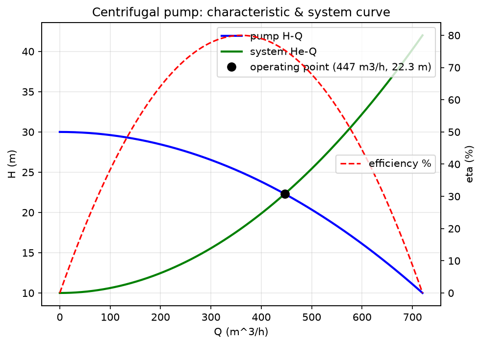

# 第 03 讲：流体输送机械（泵）

> **前置**：第 02 讲（伯努利方程、压头、阻力损失）｜ **预计时间**：3 小时（含作业）
>
> **一句话定位**：这一讲把"泵"从你眼里的一小段管子，升级成一台**有方向、有脾气、有安装限制**的机器——它给流体充能量（扬程），但进出口不能反、装太高会"气蚀"罢工。学完你能写出关于泵的一整套软/硬约束。
>
> **本讲回答什么**：
> 1. 离心泵凭什么把流体送出去？为什么它有固定的进出口方向？
> 2. 一台泵到底能送多少流量、顶多高压头？（特性曲线 H-Q）
> 3. 泵接到具体管路上，实际会在哪个流量下工作？（工作点 = 泵曲线与管路曲线的交点）
> 4. 为什么泵不能装得离液面太高？（气蚀与允许安装高度）
> 5. 这些怎么变成逆向作业里关于"泵"的约束？
>
> **这一讲有真实验证**：关死点扬程 30 m、最大流量 882 m³/h；最佳效率点 η=0.80；工作点 Q\*=447 m³/h、H\*=22.308 m（两曲线交点闭合到 −9.4e−11）、轴功率 36.01 kW；允许安装高度 Hg=6.590 m。脚本 `scripts/lec03-01_verify_pump_curve.py`。
>
> **本讲目标（学完你能）**：
> - 能说出离心泵的进出口方向、并用"泵要有下游去向"这条约束检查一张图。
> - 能由泵特性曲线和管路特性曲线求工作点（流量、扬程）。
> - 能算泵的允许安装高度，并解释气蚀。
> - 能列出至少 3 条关于泵的逆向软约束。
>
> 目标达成 = 末尾"掌握度自测"全打勾。

## 本讲怎么走（脉络图）

```
成品开场（算出一台泵接管路后的工作点）
   ↓
离心泵怎么工作 —— 叶轮甩水，中心吸、边缘排 → 有方向   [直]（破误会 M2）
   ↓
泵特性曲线 H-Q —— 这台泵"能给多少压头 vs 送多少流量"  [用]
   ↓
管路特性曲线 + 工作点 —— 两曲线交点=实际运行点         [推]
   ↓
效率与轴功率 —— 泵在哪个流量最省、要配多大电机         [用]
   ↓
气蚀与允许安装高度 —— 泵为什么不能装太高              [用]
   ↓
其他输送机械（往复泵/压缩机/风机）                    [知]
   ↓
这些怎么变成逆向作业的软约束                          [用]
   ↓
小结 → 自测 → 作业
```

---

## 一、成品开场：算出一台泵接管路后的工作点

你逆向出一条连接：`储罐 T-101 →（泵 P-101）→ 送去高处某设备`。第 02 讲你能判断"流向对不对"，但还有个更实际的问题没答：**这台泵开了以后，到底每秒送多少料？能把料顶多高？**

这一讲学完你能算出来。给你一台泵（关死点扬程 30 m）和一条管路（要把流体提升 10 m），答案是一个确定的**工作点**：

> **实测（脚本 EXP3）：流量 $Q^* = 447$ m³/h、扬程 $H^* = 22.3$ m，轴功率 36 kW。**

这个点是"泵能提供的"和"管路需要的"两条曲线的交点——泵不可能凭空多送或少送，它只会稳定在这个交点上。下面把这台泵拆开讲清楚。

---

## 二、离心泵怎么工作：它天生有方向

**理解层次：直（建立直觉）**

### 2.1 结构直觉（不抠机械细节）

**离心泵**（centrifugal pump）最常见的输送液体设备。核心是一个高速旋转的**叶轮**（impeller，一个带叶片轮子），装在一个蜗壳形的泵体里。工作过程说人话：

1. 流体从叶轮**中心（轴向）**被吸进来；
2. 叶轮旋转，叶片把流体**甩向外缘（径向）**，越甩越快；
3. 高速流体进入蜗壳，速度被"收"成压力，从**排出口**顶出去。

**能量转换**：电机的机械能 → 叶轮给流体的动能 → 蜗壳转成压力能（压头）。这就是第 02 讲伯努利方程里那个 $H_e$（泵扬程）的来源。

### 2.2 于是泵天生有方向

由上面的过程直接得出两条**铁律**：

- **吸入口在中心（轴向）、排出口在外缘（径向）**：进出口**不能反接**。反接了叶轮甩不动流体，泵不上量。
- **流体只能从吸入流向排出**：泵是单向"充能"元件。

> **打破常见误会（M2）**：别把泵当成"一段随便接的管子"。它有明确的**吸入侧（inlet/suction）**和**排出侧（outlet/discharge）**。逆向作业时，如果你把某个设备的出口错接到泵的排出侧、或让流体从泵排出侧倒灌回吸入侧，这条连接在物理上就是错的。**认出"这是泵"，就自动得到"它有进有出、方向固定"这条约束。**

现场怎么快速认离心泵：一个**圆形蜗壳体**（像蜗牛壳），**轴向一个入口、切向一个出口**，后面通常直接连着**电机**（一个更大的圆筒）。chat 素材里"泵状设备：电机与进出口"说的就是这个识别线索。

---

## 三、泵特性曲线 H-Q：这台泵的"能力表"

**理解层次：用（会读会用）**

一台泵不是"固定送多少"，而是**送得越多、能顶的压头越小**——这两者的关系叫**特性曲线**（characteristic curve）。

### 3.1 扬程-流量曲线（H-Q）

**扬程** $H$（head，单位 m）：泵给单位重量流体充的能量，即第 02 讲的 $H_e$。工程上离心泵的 H-Q 曲线常近似成一条下抛物线：

$$H = H_0 - a Q^2$$

- $H_0$：**关死点扬程**（shutoff head）——出口阀全关、$Q=0$ 时泵能顶的最大压头。
- $a$：曲线陡度系数；$Q$：体积流量。

**实测（脚本 EXP1）**：本例 $H_0=30$ m、$a=500$（$Q$ 用 m³/s）。
- 关死点扬程 $H(Q{=}0) = 30$ m；
- 最大流量（$H=0$）$Q_{max}=\sqrt{H_0/a}=\sqrt{30/500}=0.2449$ m³/s $=882$ m³/h。

直觉：**流量和扬程是"此消彼长"的**——想要大流量，就没多少富余压头；想要高压头，流量就小。一台泵不能既要又要。

### 3.2 还有两条配套曲线

- **效率曲线 η-Q**：泵把电机功率转成流体有效功率的比例，随流量先升后降，有一个**最佳效率点 BEP**（best efficiency point）。实测本例 BEP 在 $Q\approx0.10$ m³/s、$\eta_{max}=0.80$。
- **轴功率曲线 N-Q**：泵轴实际需要的功率（下面第五节算）。选电机要看它。

**理解层次**：H-Q 要会用；η-Q、N-Q 会读即可。

---

## 四、管路特性曲线 + 工作点：泵实际在哪运行

**理解层次：推（要会求工作点）**

### 4.1 管路"需要"多少压头

泵"能给"多少是一条曲线；管路"需要"多少是另一条。由第 02 讲的实际伯努利方程，要让流体流过一条管路，泵必须提供的压头 = 提升高度 + 顶过压差 + 补掉摩擦损失：

$$H_e = \Delta z + \frac{\Delta p}{\rho g} + h_f$$

摩擦损失 $h_f$ 随流速平方增大（第 02 讲 Darcy），而流速正比于流量，所以 $h_f \propto Q^2$。把常数项合并，**管路特性曲线**写成：

$$H_e = \Delta z_{\text{eff}} + K Q^2$$

- $\Delta z_{\text{eff}}$：**静扬程**——不随流量变的固定部分（提升高度 + 压差）；
- $K$：管路阻力系数；$KQ^2$ 是随流量变的摩擦部分。

### 4.2 工作点 = 两条曲线的交点

泵实际运行时，它"给"的压头必须正好等于管路"要"的压头——所以工作点就是两条曲线的交点：

$$H_0 - aQ^2 = \Delta z_{\text{eff}} + KQ^2$$

解出：

$$Q^* = \sqrt{\frac{H_0 - \Delta z_{\text{eff}}}{a + K}},\qquad H^* = H_0 - a Q^{*2}$$

**手算本例**（$H_0=30$、$a=500$、$\Delta z_{\text{eff}}=10$、$K=800$）：

$$Q^* = \sqrt{\frac{30-10}{500+800}} = \sqrt{\frac{20}{1300}} = \sqrt{0.01538} = 0.1240 \text{ m}^3/\text{s} = 447 \text{ m}^3/\text{h}$$

$$H^* = 30 - 500\times0.1240^2 = 30 - 7.69 = 22.31 \text{ m}$$

**实测（脚本 EXP3，用 `scipy.optimize.brentq` 数值求根）**：$Q^*=0.1240$ m³/s（447 m³/h）、$H^*=22.308$ m，交点残差 $-9.4\times10^{-11}$（机器精度下就是 0，两曲线严丝合缝相交）。



> **这个交点的意义（对逆向作业）**：工作点是"泵能力"和"管路需求"的**唯一平衡点**。如果你逆向出的管路（长度、管径、提升高度）配这台泵，算出来的工作点流量小得离谱、甚至 $H_0 < \Delta z_{\text{eff}}$（根号里为负，无解）——那说明**这台泵根本顶不动这条管路**，你的拓扑就自相矛盾了。这是又一条能自动检查的合理性约束。

---

## 五、效率与轴功率：泵要多大电机

**理解层次：用（会算轴功率）**

泵的**有效功率**（真正传给流体的）：

$$N_e = \rho g Q H$$

但泵有机械/水力损失，电机要出更多，用效率 $\eta$ 折算出**轴功率**：

$$N = \frac{N_e}{\eta} = \frac{\rho g Q H}{\eta}$$

**实测（脚本 EXP3）**：工作点处 $\eta=0.754$，

$$N = \frac{1000\times9.81\times0.1240\times22.308}{0.754} = 36.01 \text{ kW}$$

即这台泵在工作点要配约 36 kW 的电机。

> **为什么要关心 BEP**：泵长期偏离最佳效率点（$\eta$ 低）运行，既费电又易损坏（振动、发热）。工程上选泵要让工作点尽量靠近 BEP。本例工作点 $Q^*=0.124$、BEP 在 $0.10$，比较接近，效率 0.754 尚可。**理解层次：知道有这回事即可。**

---

## 六、气蚀与允许安装高度：泵为什么不能装太高

**理解层次：用（会算安装高度、会解释气蚀）**

### 6.1 气蚀是什么

**气蚀**（cavitation）：泵吸入侧压力如果低到**等于或低于液体的饱和蒸气压**，液体就在泵里**沸腾汽化**、产生气泡；气泡随流体冲到高压区又**瞬间溃灭**，像无数微型水锤砸叶轮——噪声、振动、叶轮被啃出麻点，泵迅速报废。

关键：**泵是把流体"吸"进来的**（靠叶轮中心形成的低压），吸力有限。装得离液面越高，吸入侧压力越低，越容易气蚀。

### 6.2 允许安装高度公式

泵能装在吸入液面**上方**的最大高度 $H_g$（m）：

$$H_g = \frac{p_0 - p_v}{\rho g} - \text{NPSH}_r - h_{f,s}$$

逐个符号说清（不空降）：
- $p_0$：吸入液面的压力（Pa）。敞口罐就是大气压 101325 Pa。
- $p_v$：液体在操作温度下的**饱和蒸气压**（Pa）——液体开始沸腾的压力，20℃ 水约 2339 Pa。
- $\dfrac{p_0-p_v}{\rho g}$：液面压力"扣掉蒸气压"后，还剩多少压头能用来把液体往上吸。
- $\text{NPSH}_r$：**必需净正吸入压头**（Net Positive Suction Head required，m），泵厂家给的一个安全余量，防止泵内最低压点掉到蒸气压以下。
- $h_{f,s}$：吸入管路的摩擦损失（m）。

**实测（脚本 EXP4）**：$p_0=101325$、$p_v=2339$、$\text{NPSH}_r=3.0$、$h_{f,s}=0.5$：

$$H_g = \frac{101325-2339}{1000\times9.81} - 3.0 - 0.5 = 10.090 - 3.5 = 6.590 \text{ m}$$

即这台泵最多装在吸入液面**上方 6.59 m**，再高就气蚀。

> **软约束来源**：现场看到一台离心泵，它相对上游储罐液面的**安装高度是有限制的**。如果你逆向的拓扑里，泵被摆得离供料罐液面很高、中间又没有别的增压，这违反气蚀限制，可疑。反过来，泵通常装在**低位、靠近储罐底部出口**——这正是 chat 素材"储罐底部可能有出料口""泵通常存在吸入口和排出口"背后的物理。

---

## 七、其他输送机械：认识即可

**理解层次：知（知道有这回事 + 什么时候查）**

离心泵不是唯一的输送设备。逆向时你可能撞到别的：

| 设备 | 是什么 | 和离心泵的关键差别 |
|---|---|---|
| **往复泵 / 正位移泵** | 靠活塞/隔膜周期性改变容积把流体"挤"出去（reciprocating / positive displacement pump） | 流量几乎不随压头变、能产生很高压；**出口不能堵死**（会憋爆），必须配安全阀 |
| **齿轮泵 / 螺杆泵** | 也是正位移泵，靠齿轮/螺杆啮合输送，适合粘稠液体 | 同上，正位移特性 |
| **压缩机** | 输送并**压缩气体**（提高气体压力） | 处理气体不是液体；气体可压缩，逻辑不同 |
| **风机 / 鼓风机** | 输送气体、只提高一点压力 | 低压气体输送 |
| **真空泵** | 把容器抽到低于大气压 | 产生负压而非正压 |

**这一讲只要求你：认出"这不是离心泵而是别的输送机械"，知道正位移泵"出口不能堵死"这条与离心泵相反的约束即可。** 详细的特性曲线不在本课展开（属专门课程）——这是"知道有这回事 + 什么时候查"档。

---

## 八、这些怎么变成逆向作业的软约束

把这一讲翻译成能写进图/求解器的规则：

1. **泵有吸入口和排出口，方向固定**（硬约束级别）：图里泵节点必须 in_degree ≥ 1 且 out_degree ≥ 1（第 01 讲脚本已检查过）；流体只能吸入→排出，不能反。
2. **泵必须有下游去向**：排出侧不能又接回自己的吸入侧（第 01 讲作业 D 那个死循环）——那是废流程。
3. **泵通常靠近储罐底部出口、装在低位**（软约束）：受气蚀/安装高度限制，泵离供料液面不能太高。
4. **泵-管路要匹配**（软约束）：给定的提升高度不能超过泵的关死点扬程（$H_0 > \Delta z_{\text{eff}}$ 才有工作点），否则拓扑不自洽。
5. **正位移泵出口不能堵死**（软约束）：若认出是往复泵/齿轮泵，它下游不能是完全封闭的死路，应有安全阀/去向。

这些让"泵"这个节点从第 01 讲的"一个 kind 标签"，变成了**带一堆可检查约束的实体**。

---

## 本讲小结

- **离心泵**：叶轮中心吸、外缘排，把机械能转成流体压头（伯努利里的 $H_e$）。**天生有方向**——吸入侧/排出侧不能反（破除 M2）。识别线索：蜗壳体 + 轴向入口 + 切向出口 + 电机。
- **特性曲线 H-Q**：$H=H_0-aQ^2$，流量与扬程此消彼长。关死点扬程 $H_0=30$ m、最大流量 882 m³/h（实测）。
- **工作点**：泵曲线与管路曲线 $H_e=\Delta z_{\text{eff}}+KQ^2$ 的交点，$Q^*=\sqrt{(H_0-\Delta z_{\text{eff}})/(a+K)}$。实测 $Q^*=447$ m³/h、$H^*=22.3$ m、交点闭合到 −9.4e−11。
- **轴功率** $N=\rho g QH/\eta$：实测工作点 36 kW；泵宜在最佳效率点 BEP 附近运行。
- **气蚀与安装高度**：吸入压力低于蒸气压→液体汽化溃灭→毁泵。$H_g=\frac{p_0-p_v}{\rho g}-\text{NPSH}_r-h_{f,s}$，实测 6.59 m。所以泵装低位、近罐底。
- **其他输送机械**（认识即可）：正位移泵（往复/齿轮）出口不能堵死、能高压；压缩机/风机/真空泵处理气体或负压。
- **5 条泵的软/硬约束**：有进有出方向固定、要有下游去向、装低位近罐底、泵-管路要匹配、正位移泵出口不堵死。

## 掌握度自测

- [ ] 我能说出离心泵的吸入/排出方向，并解释为什么不能反接。
- [ ] 我能由 H-Q 曲线说出关死点扬程和最大流量。
- [ ] 我能由泵曲线和管路曲线求工作点（$Q^*, H^*$），并解释工作点的物理意义。
- [ ] 我能算轴功率 $N=\rho gQH/\eta$。
- [ ] 我能解释气蚀、算允许安装高度，并说出"泵为什么装在低位"。
- [ ] 我能列出至少 3 条关于泵的逆向软约束。

## 作业

**A.（数值题·工作点）** 一台泵 $H=25-400Q^2$（$Q$ 单位 m³/s），接一条管路 $H_e=5+600Q^2$。求工作点 $Q^*$（m³/s 和 m³/h）与 $H^*$。

<details><summary>参考答案</summary>

令两式相等：$25-400Q^2 = 5+600Q^2$ → $20 = 1000Q^2$ → $Q^2=0.02$ → $Q^*=\sqrt{0.02}=0.1414$ m³/s。

换算：$0.1414\times3600=509$ m³/h。

$H^*=25-400\times0.02=25-8=17$ m。（用管路式校核：$5+600\times0.02=5+12=17$ m，一致 ✓）

判据：$Q^*\approx0.141$ m³/s（≈509 m³/h）、$H^*=17$ m，两式回代相等。
</details>

**B.（概念题·气蚀）** 同一台泵，夏天输送 60℃ 热水（饱和蒸气压约 19.9 kPa）比冬天输送 20℃ 冷水（2.34 kPa）更容易气蚀。用允许安装高度公式解释为什么，并说明操作上能怎么办。

<details><summary>参考答案</summary>

$H_g=\dfrac{p_0-p_v}{\rho g}-\text{NPSH}_r-h_{f,s}$。温度升高 → 饱和蒸气压 $p_v$ 从 2.34 kPa 猛增到 19.9 kPa → 分子 $(p_0-p_v)$ 变小 → 第一项 $\dfrac{p_0-p_v}{\rho g}$ 变小 → 允许安装高度 $H_g$ 变小。即热水时泵必须装得**更低**才不气蚀；若安装高度不变，夏天就容易气蚀。

（量级感受：冷水时第一项 $\approx\frac{101325-2339}{9810}=10.09$ m；热水时 $\approx\frac{101325-19900}{\rho g}$，且 60℃ 水 $\rho\approx983$，$\approx\frac{81425}{983\times9.81}=8.45$ m，一下少了约 1.6 m 的余量。）

操作办法：① 把泵装得更低（甚至让吸入液面高于泵，靠液位差把料压进泵、抬高吸入侧压力）；② 减小吸入管路损失 $h_{f,s}$（用更粗/更短的吸入管、少用弯头）；③ 降低液体温度；④ 选 $\text{NPSH}_r$ 更小的泵。

判据：说清"$p_v$ 升→$H_g$ 降"的链条，并给出 ≥2 个操作对策。
</details>

**C.（代码题·安装高度）** 写一段 Python：给定 `p0=101325, rho=1000, g=9.81, NPSHr=3.0, hf_s=0.5`，对蒸气压列表 `pv_list=[2339, 7384, 19900]`（约对应 20/40/60℃ 水）逐个算允许安装高度 $H_g$ 并打印。

<details><summary>参考答案</summary>

```python
p0, rho, g = 101325.0, 1000.0, 9.81
NPSHr, hf_s = 3.0, 0.5
for pv in [2339, 7384, 19900]:
    Hg = (p0 - pv) / (rho * g) - NPSHr - hf_s
    print(f"pv={pv} Pa -> Hg={Hg:.3f} m")
```

预期输出（数量级）：
```
pv=2339 Pa  -> Hg=6.590 m
pv=7384 Pa  -> Hg=6.076 m
pv=19900 Pa -> Hg=4.799 m
```
（注：这里对三档都用了 $\rho=1000$ 简化；严格算高温水密度会略降，$H_g$ 还会再小一点。）判据：$H_g$ 随 $p_v$ 增大而单调减小。只用本讲公式。
</details>

**D.（综合题·软约束）** 你逆向时认出一个节点是离心泵 P-101，观察到：它上游接储罐 T-101 底部出口（确认），下游有一根管但终点被遮挡（推测）。请结合本讲，列出你对"P-101 下游那条边"能施加的所有约束/判断（哪些能当硬约束、哪些只能当软约束打分）。

<details><summary>参考思路</summary>

**硬约束（几乎必成立）**：
- P-101 必须 in_degree≥1 且 out_degree≥1（已由上游 T-101→P-101 满足 in；下游那条边就是它的 out，所以这条边**大概率真实存在**，否则泵没有排出侧，不合理）。
- 方向：流体从吸入侧（接 T-101）流向排出侧（下游那条边），不能反。
- 下游不能直接接回 P-101 自己的吸入侧（死循环，废流程）。

**软约束（打分用，可能被教学模型/假管违反）**：
- 下游应通往"需要被提升/被加压"的去向（高处设备、下游塔/换热器），因为泵的作用就是提压头；若下游是往低处自流且不接任何设备，泵的存在意义存疑。
- 泵-管路要匹配：下游管路的静扬程不能超过这台泵的关死点扬程，否则拓扑不自洽（可作为一致性检查）。
- 若下游那条边终点被遮挡，应标 confidence=medium/推测、用虚线，并列入"无法确认连接"清单，而不是硬编一个终点（第 01、12 讲的记录纪律）。

判据：区分出硬约束（进出口/方向/不死循环）与软约束（去向合理/泵管匹配），且对"被遮挡的下游"给出"标推测、不硬编"的处理。
</details>

---

*下一讲（第 04 讲）：阀门·管件·仪表 + P&ID 识读。你已经认识了罐、泵、换热器（第 05 讲细讲）；下一讲把管路上那些"小东西"——阀门、法兰、三通、仪表——和整张图的符号语言（P&ID）讲清楚，让你能把前两讲的设备和约束，落成一张能交付的流程图。*
