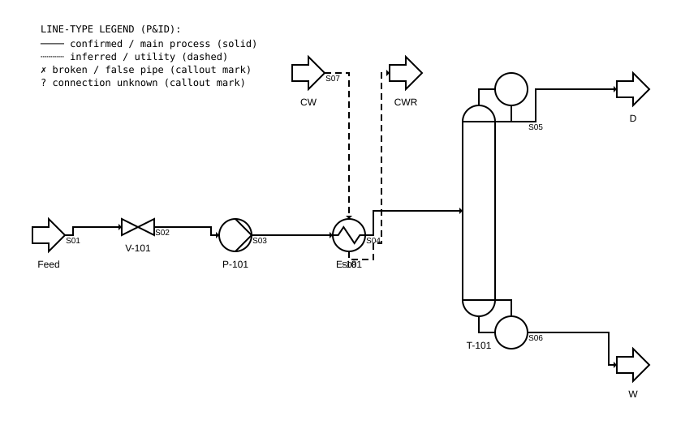

# 第 04 讲：阀门·管件·仪表 + P&ID 识读

> **前置**：第 02、03 讲（流体流动、泵已经认识）｜ **预计时间**：2.5 小时（含作业）
>
> **一句话定位**：前几讲你认识了"大件"（罐、泵、换热器、塔），这一讲把管路上那些**小东西**——阀门、法兰、三通、仪表——和整张图的符号语言（P&ID）讲清楚，让你能把前几讲的设备和约束，落成一张可交付的流程图。
>
> **本讲回答什么**：
> 1. 现场看到的阀/仪表/法兰，对应的 P&ID 符号长什么样？怎么快速认？
> 2. "仪表是支路不是主物流通路"这条软约束**为什么成立**？
> 3. 正规 P&ID 的线型和管线编号长什么样？和 chat1 里的线型语义有什么关系？
> 4. 怎么把前几讲的东西画成一张能交的图？
>
> **这一讲有真实验证**：pyflowsheet 生成的简化 P&ID SVG（`figures/lec04_pid_snapshot.svg`，含阀门符号、实线主流程、虚线公用工程、图例）。脚本 `scripts/lec04-01_pid_snapshot.py`。
>
> **本讲目标（学完你能）**：
> - 能认出常见阀门、管件、仪表符号，并说出对应的英文/缩写。
> - 能解释"仪表是支路"的物理与工程原因。
> - 能读简化 P&ID，并能把现场观察翻译成一套带线型的图。
> - 能用前几讲的工具画出一张可交付的简化流程图。
>
> 目标达成 = 末尾"掌握度自测"全打勾。

## 本讲怎么走（脉络图）

```
成品开场（打开一张 P&ID：能认出上面的阀门、仪表、线型）
   ↓
阀门类型 —— 现场见到的各种"把手"对应什么阀                 [用]
   ↓
管件与连接 —— 法兰、螺纹、焊接、三通、变径                 [用]
   ↓
仪表符号 —— 为什么仪表只是"支路"（软约束来源）              [用]
   ↓
P&ID 图例与线型 —— 正式 P&ID 的线型约定 vs 本课的简化版     [用]
   ↓
管线编号 —— "管子"的正式身份证                            [知]
   ↓
逆向作业里的 P&ID 思维                                       [用]
   ↓
小结 → 自测 → 作业
```

---

## 一、成品开场：打开一张 P&ID，你看到什么

下面这张图是用 pyflowsheet（第 03 讲你见过的那个库）生成的简化 P&ID。**把它在浏览器里打开看**——现在你已经能认出上面的东西了：


> SVG 用浏览器直接打开，可缩放。若嵌入显示不全请单独打开文件 `figures/lec04_pid_snapshot.svg`。

这张图里有：
- **阀门 V-101**（FCV-101，进料调节阀）——六边形叉号符号；
- **泵 P-101**（Feed Pump）——圆形带 V 形内部线条；
- **换热器 E-101**（Preheater）——圆内含 S 形热交换管；
- **精馏塔 T-101**——圆形底+直筒身（带冷凝器与再沸器）；
- 进出料**StreamFlag**（Feed/Distillate/Bottoms）——箭头旗标；
- 实线（S01–S06）= **确认的主工艺连接**；
- 虚线（S07–S08，S 形冷却水管）= **公用工程/推测连接**——体现第 01 讲的线型语义；
- 左上角图例直接说明了实/虚/叉/问号四种线型的含义。

学完这一讲，你不只能认出它们，还能**自己画一张**——用 pyflowsheet、drawio 或手绘，都行。

---

## 二、阀门类型：现场见到的各种"把手"

**理解层次：用（要识别 + 知道功能）**

阀门是管路上的**开关或调节元件**——控制流体通断、流量或方向。现场你会见到各种"手轮""手柄""齿轮""气缸"，不同外形对应不同功能。

| 阀门类型 | 常见外形线索（现场识别用） | P&ID 符号特征 | 功能 |
|---|---|---|---|
| **闸阀**（gate valve） | 手轮，阀杆伸出，阀门本体扁长方形 | 两个倒 V 形尖对尖 | 全开/全关，做隔离用，**不适合节流** |
| **截止阀**（globe valve） | 手轮，阀体呈球形或 S 形 | 圆中竖线 | 可调节流量（节流） |
| **球阀**（ball valve） | 手柄 90° 旋转，阀本体球形 | 圆中 X 或球示意 | 快速开/关，全开口，压降小 |
| **蝶阀**（butterfly valve） | 手柄 90°，薄圆盘状，像蝴蝶 | 两条弧线相对 | 大口径，快速开/关或调节 |
| **止回阀**（check valve） | 无手轮，一端带铰链或弹簧 | 圆中箭头或单向半圆 | 只允许单向流动，防止倒流 |
| **安全阀**（safety/relief valve） | 带弹簧罩和排气管 | 圆中一条线加弹簧示意 | 超压自动开启泄压，保安全 |
| **调节阀 / 控制阀**（control valve） | 带**执行器**（气动头/电动头，一个大圆筒在阀顶），常有定位器 | 阀符号 + 顶部半圆弧（执行器） + 仪表线 | 自动调节流量/压力，由控制信号驱动 |

> **逆向作业里怎么用**：认出阀门类型就自动知道它的功能——闸阀=隔离/关断，止回阀=这个方向不能流，安全阀=这块有压力保护要求。**这些直接变成你约束图里的软约束依据**（例如：止回阀方向不能反；安全阀不应装死路等）。

---

## 三、管件与连接

**理解层次：用（要识别）**

管路上除了阀门，还有各种 "小块头" 管件（fitting）。对作业最重要的是**法兰**（flange）和**三通**（tee）。

### 3.1 法兰、螺纹、焊接

管子之间的连接方式有三种：

| 方式 | 识别线索 | 含义 |
|---|---|---|
| **法兰连接**（flanged） | 两根管相碰处有**一圈凸起圆盘**，上面有螺栓孔 | **可拆卸连接**——可以拧开检修。**这是现场判断"这是真连接"的重要证据**：两端都看到法兰才说明它们大部分时候是相连的 |
| **螺纹连接**（threaded） | 接头上有螺纹旋纹，常见于小管径 | 可拆卸，但密封性不如法兰 |
| **焊接**（welded） | 接缝处没有凸起圆盘、只有一道焊口 | **永久连接**，不可拆 |

> **chat 素材的关键线索**：你们在现场判断"这根管是否真的接进那个设备"，最重要的观察之一就是**法兰**。看到两端都有法兰且螺栓拧紧，大概率是真连接。看不到法兰但管子"一段伸进去消失"——**标未知**，不标确认。

### 3.2 三通与变径

| 管件 | 识别 | 逆向意义 |
|---|---|---|
| **三通**（tee） | T 字或 Y 字接头，一根管分成两个方向 | **分叉节点**——现场看到三通，意味着这段管线有**旁路（bypass）或分流**，求解器要生成两个候选边 |
| **变径**（reducer / expander） | 一段锥形过渡，从粗到细或细到粗 | 提示此处可能有**流速/压力变化**（第 02 讲：连续性方程），通常配合阀或仪表使用 |
| **弯头**（elbow） | L 形拐弯，有 45°/90° | 正常——只要是连续拐弯且两端都有连接，就是真管 |
| **盲板 / 封堵**（blind / cap） | 管端被圆形钢板封死或圆盖堵住 | **此处不通**——如果是真管，它就是死路（用来隔离/吹扫）。但如果出现在奇怪位置，可能是假管 |

---

## 四、仪表符号

**理解层次：用（要识别 + 知道"仪表是支路"的原因）**

### 4.1 常见仪表（现场简化版）

P&ID 里的仪表用一个**圆圈**（或带框的圆）表示，里面写功能字母。**这不是现场设备的实物外形，而是它在图纸上的符号**。现场实物可能是变送器、传感器、开关、面板上的表。

| 缩写 | 仪表 | 在现场通常长什么样（外形线索） |
|---|---|---|
| **PI** | 压力表（Pressure Indicator） | 圆形表盘、指针，常在泵出口/罐顶 |
| **TI** | 温度计 / 温度仪表（Temperature Indicator） | 带不锈钢套管的探头（热电阻/热电偶），或玻璃温度计；常见于换热器进出口 |
| **LI** | 液位计（Level Indicator） | **玻璃管/磁翻板液位计**（现场最容易认——一根竖着的透明管或红白翻板，两边有两个小阀门），或雷达/压差式（看不到探头） |
| **FI** | 流量计（Flow Indicator） | 带一段直管段、两端法兰、中间有测量元件（孔板/涡街/电磁） |
| **FT** | 流量变送器 | 流量计 + 电子信号输出（带接线盒） |
| **FV** | 流量调节阀 | 控制阀 + 流量信号闭环（前面"调节阀"说的） |
| **PSV / PRV** | 安全阀（前面已讲） | — |
| **PC / TCV** | 压力/温度控制器 | 控制器的功能符号 |

> **P&ID 识读的核心习惯**：看到圆圈里的三字母，如 **PT-101**，拆成 P（测量变量: Pressure）+ T（功能: Transmitter 变送器）+ 101（回路编号）。**这种命名规则本课认识即可，不必背**——遇到去查就行。

### 4.2 "仪表是支路"——为什么成立

这是 chat 素材里反复出现的一条**软约束**。物理原因：

- **测量不能打扰主流**：压力表、温度计等测量元件通过一个**小支管（impulse line / thermowell）**与主管道连接，只取一小段引流到传感器，不影响主流。
- **液位计 = 连通器**：罐旁边的玻璃管或翻板液位计，就是两根小支管（上/下各一根）接到罐的侧面，构成 U 形连通器，**不参与物料进出**。
- **流量计 = 在线仪表**：流量计本身是主工艺管的一段（有流量计就会切断一段主管），所以它**不是支路——但它的信号（4-20 mA / 数字）是支路**。你从 P&ID 上能看到从流量计引出的**信号线**到控制室。

> **后果**：如果你在逆向图中看到一根管从罐侧面引出、两头都有法兰、但再看发现它其实接的是 液位计/LI——那这根管就不是"物料管线"，而是仪表支路。**约束赋值：仪表支路置信度打压，不被当作主工艺通路。**

---

## 五、P&ID 线型约定与管线编号

**理解层次：用（会用这套约定落图）**

### 5.1 正式 P&ID 的线型（认识即可），以及本课的简化版

正式 P&ID（按 ISA 5.1 等标准）的线型远比我用 pyflowsheet 生成的复杂——不同介质（工艺/公用工程/吹扫/蒸汽/保温/仪表信号）各有其线型。**本课不要求你背这几十大种线型**。

但 chat 素材和实践证明，对逆向作业来说，**只需要三 + 一种线型**就能交付报告（第 12 讲）：实线（确认）、虚线（推测）、叉号（断/假管）。**这些就写在第 01 讲第四节和本讲图例里。**

| 本课线型 | P&ID 含义（简化） |
|---|---|
| 实线 ── | **确认连接**：两端都直接看到，连续无遮挡 |
| 虚线 ┄┄ | **推测连接**：一端可见/靠走向推理；或**公用工程**（水/蒸汽，不在主流程里） |
| 叉号 ✗ | **断开/假管/非功能管**：物理断开、胶带缠、悬空不接 |
| 问号 ? | **未确认连接**：看不到、无法判断 |

> **一个诚实的边界**：如果你需要正式 P&ID（比如交答辩/审图），pyflowsheet／本课简化线型**不能替代 ISA 标准**——这里的简化只为"够交作业、够看懂现场"。正式 P&ID 需要专业制图工具（AutoCAD P&ID、SmartPlant、drawio）和制图规范。

### 5.2 管线编号（line number）

正式 P&ID 里每条管线有一个唯一编号，如 `6\"-CWS-101-316L-S1`，拆开看：

| 段 | 含义 |
|---|---|
| `6\"` | 公称直径 6 英寸 |
| `CWS` | 服务代号（Cooling Water Supply 冷却水供水） |
| `101` | 序号 |
| `316L` | 材质（不锈钢 316L） |
| `S1` | 管线等级 / 保温等级 |

**理解层次：知**——你看到编号能知道"哦这是冷却水管、6 寸、不锈钢"就行。不用背拆解规则。

---

## 六、逆向作业里的 P&ID 思维

结合前几讲学到的东西，这一讲给一个**"看到什么→想到什么"**的快速检查表，用于现场辨识：

| 看到… | 想到… | 对应约束 / 概念 |
|---|---|---|
| 两个法兰（管子—管子） | 此处**可拆**，是真连接 | **连接置信度→高** |
| 从罐侧面引出两根管到一根竖管 | 那是**液位计**（支路，不是主物流） | 仪表支路，不加到管线拓扑里 |
| 一个带手轮的 T 形件，出口改向 | **三通**，这里有**分流/旁路** | 候选边 +1（求解器要两条候选） |
| 一截锥形变径管 | 速度/压力在此突变；旁常联阀/仪表 | 连续性约束 |
| 泵入口管比出口管**粗** | 防气蚀设计（第 03 讲） | 安装合理性检查 |
| 一根管从排气口通到某处 | **安全阀排气管**，泄压用，非正常工艺 | 标推测，不纳入主工艺拓扑 |
| 无支撑、悬空断开的管 | **假管 / 断管** | 标 ✗，不连 |
| 胶带缠绕的管 | 不可区分功能，**无法确认** | 标 ?（未知） |
| 喷漆颜色不同的管 | 可能区分不同介质/服务 | 可作为推测线索，但不绝对 |

---

## 本讲小结

- **阀门**：闸/截止/球/蝶/止回/安全/调节阀。认出类型 = 得到功能约束（止回阀方向、安全阀泄压）。
- **管件**：法兰=可拆连接（**置信度证据**）、三通=分叉/旁路节点、变径=流速变化配合阀/仪表。
- **仪表**：PI/TI/LI/FI 等圆圈符号。**仪表是支路**（软约束）——从主管取一小段信号，不参与主物流。
- **P&ID 线型**（本课简化版）：实线=确认、虚线=推测/公用工程、叉号=断/假管、问号=未知。
- **管线编号**：知道它能读就行（用/材/编号），不用背拆解。
- **快速检查表**：把"看到什么"翻译成"想到什么约束/概念"，是逆向作业现场识别的核心技能。

## 掌握度自测

- [ ] 我能认出闸阀、止回阀、调节阀的外形区别，并说出 P&ID 符号特征。
- [ ] 我能解释"仪表是支路"的物理原因，并说出这条软约束在逆向作业里怎么用。
- [ ] 我能按本课简化线型（实/虚/叉/问）给一段现场描述配正确的线型。
- [ ] 我能用 pyflowsheet 或 drawio 画出一张含阀门、设备、实/虚线的简化流程示意图。

## 作业

**A.（概念题·符号识别）** 现场管子接头处看到：一圈凸起圆盘、上有螺栓孔、盘间有垫片。这是什么连接方式？它在逆向作业里对"连接置信度"有什么影响？

<details><summary>参考答案</summary>

**法兰连接**（flanged connection）。可拆连接——可以通过拧松螺栓拆卸。**对逆向作业**：两端都看到法兰且螺栓拧紧，说明该处是**有意的、正常的、可维护的工艺连接**，大大增加这条边的连接置信度。反之，如果一根管一端消失在设备里、从头到尾没看到法兰也没有焊口，那就是"未知"——你没法确认它是否真的接进去了。

判据：答出"法兰"，且说清"两端法兰 = 置信度高；不见法兰 / 焊口 = 可能未确认"。
</details>

**B.（概念题·线型配对）** 给以下每段描述配一个本讲线型（实线/虚线/叉号/问号）：① 罐底到泵入口，全程可见；② 泵出口管朝换热器方向走，中间被遮挡；③ 有根管在二楼悬空 30 cm，两端无连接；④ 有根管穿过铁板后消失，终点不明。

<details><summary>参考答案</summary>

① **实线**（确认：两端都看到，连续无遮挡）
② **虚线**（推测：一端可见另一端被挡，靠走向推测）
③ **叉号**（断/假管：悬空无连接）——若只开到它不接任何设备的"断管"，就标叉号；但如果你只是"没看到两端用法兰连接"但管子连续，则标问号。描述里明确"两端无连接"→标叉号。
④ **问号**（未知：消失/看不到终点，无法判断）

判据：答案全对；③ 可能有人存疑（问号 vs 叉号），解释见上，关键是对标叉号的判断条件说明自洽。
</details>

**C.（代码题·画图）** 参照本讲 `scripts/lec04-01_pid_snapshot.py` 模板，用 pyflowsheet 给以下结构画一张简化流程图（输出 SVG）：`罐 T-101 → 阀门 V-101 → 泵 P-101 → 换热器 E-101 → 塔顶采出 D`。不需要冷却水线和其他设备。

<details><summary>参考答案</summary>

```python
from pyflowsheet import Flowsheet, HeatExchanger, Pump, Valve, StreamFlag, SvgContext

pfd = Flowsheet("HW04", "Homework P&ID", "Simplified PFD for assignment")
Tank = StreamFlag("T-101", "T-101 Tank", position=(0, 200))
V1   = Valve("V-101", "FCV-101", position=(120, 200), size=(40, 20))
P1   = Pump("P-101", "Feed Pump", position=(240, 200))
HX1  = HeatExchanger("E-101", "Preheater", position=(380, 200))
Dist = StreamFlag("D", "Distillate", position=(540, 80))

pfd.addUnits([Tank, V1, P1, HX1, Dist])
pfd.connect("S01", Tank["Out"], V1["In"])
pfd.connect("S02", V1["Out"], P1["In"])
pfd.connect("S03", P1["Out"], HX1["TIn"])
pfd.connect("S04", HX1["TOut"], Dist["In"])

ctx = SvgContext("hw04_pid.svg")
pfd.draw(ctx)
ctx.render(scale=1)
print("[OK] hw04_pid.svg written")
```

判据：包含了罐/阀/泵/换热器/采出 5 个单元、4 条连接，且连接方向从 T-101 → D（不放精馏塔是因为没教它，放 StreamFlag 代表储罐/采出即可）。
</details>

**D.（综合题·软约束）** 现场发现一根管从罐 T-101 侧面（不是顶部也不是底部）引出一小段，接入一个**小型玻璃竖管**（两头有阀门）。没有手轮、没有变径、没有继续延伸。请用本讲知识判断：① 这是什么设施？② 它是不是主工艺管线？③ 在你的逆向图里该怎么标注它？

<details><summary>参考思路</summary>

① **玻璃管液位计**（LI，level indicator / glass gauge / sight glass）：两面带阀门的连通器竖管，用于就地观察罐内液位。现场极常见——辨识度极高：一根竖着的透明管上有红白磁翻板或透明玻璃，上下各有一根细短管接到罐的侧面，通常各有一个小针阀（可以关掉以便检修液位计）。

② **不是主工艺管线**。它是**仪表支路**——从罐侧面引出的一小段侧线用来接液位计，不参与物料进出。液体只在那里做连通器液位指示，不会被送走。

③ 逆向图里标注：这条支管和液位计在 P&ID 上画法不同，但作为简化逆向图，你应该：
- **不把它画成一条"从 T-101 到某处"的工艺管线**；
- 如果必须画在图上（比如为了体现现场设备完整），用**虚线**并注明"仪表支路"，置信度标 "low (instrument branch)"；
- 在备注里写"该管线非主工艺物流，仅为液位计连通管；不纳入流程拓扑"。
- **核心要点**：千万别把它当"还有一根管没追到"去猜它接去哪——它不是物料管。

判据：认出液位计、说清"非主工艺"、给出"虚线标注+备注不纳入拓扑"的处理。
</details>

---

*下一讲（第 05 讲）：传热与换热器（手册批的开始）。你已经认识了换热器符号和它的两侧进出口（TIn/TOut 管内、SIn/SOut 壳侧），第 05 讲补透传热原理和热负荷计算，顺带继续积累换热器的软约束。*