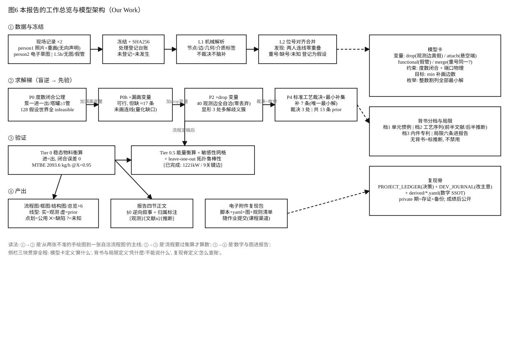
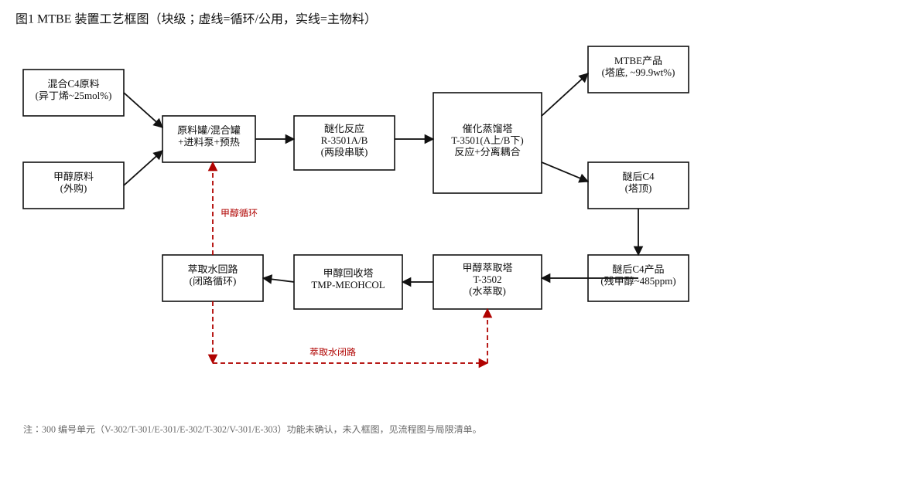
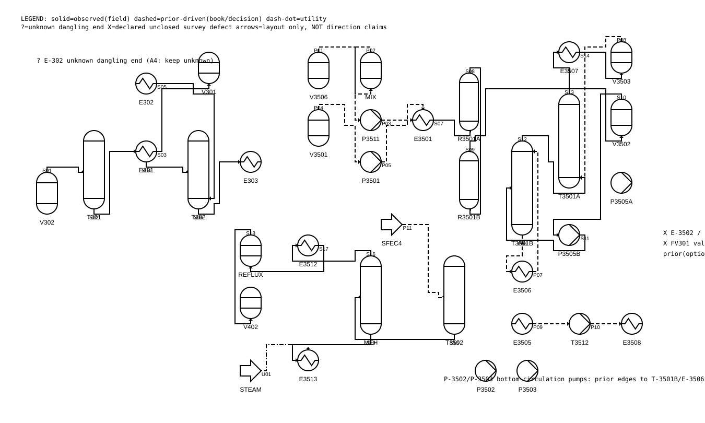
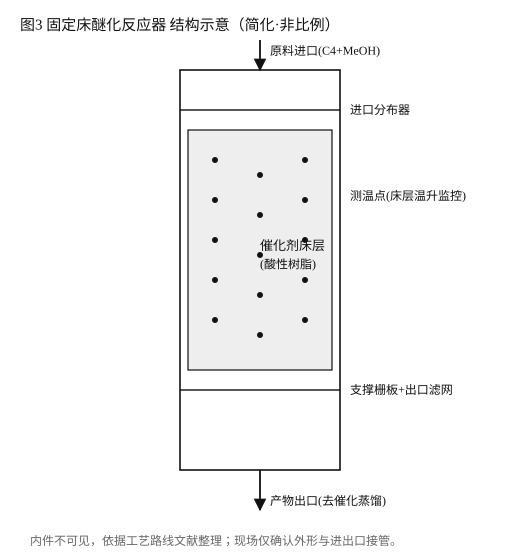
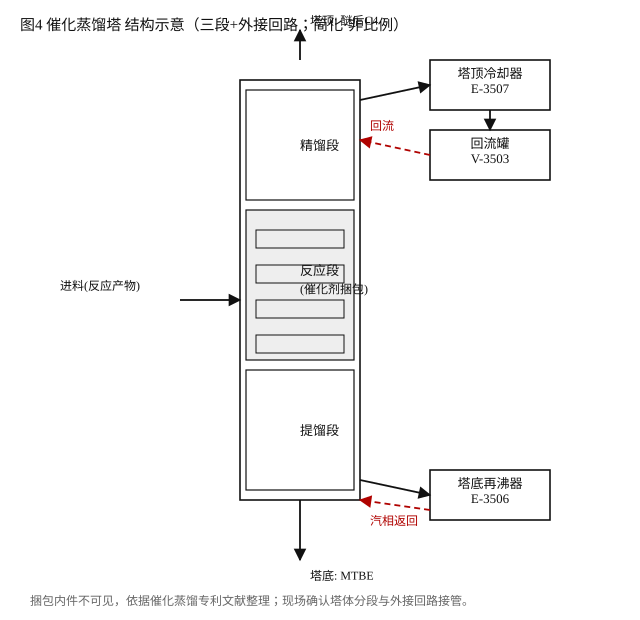
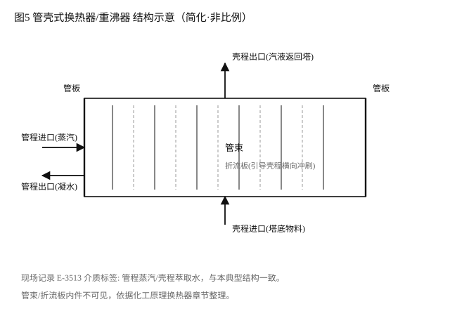

# 认识实习报告（md 底稿；最终手抄 ≥5000 字）

班级：＿＿＿＿＿＿　姓名：＿＿＿＿＿＿　院系：＿＿＿＿＿＿

> 手抄说明：正文按本稿抄写；流程图按 `work/derived/figures/flow_handcopy.md` 分四区手抄；
> 图中线型口径：实线=现场观测连线，虚线=依据标准工艺补画（prior-driven），点划=公用工程，✕=声明无法确认的设备，?=未知端。
> 引注抄写：正文方括号 [n] 抄为句末方括号编号，对应文末参考文献；无编号的叙述为现场观测或本人整理。

## 一、实习目的

认识实习是化工类专业从课堂走向装置现场的第一门实践课。本次实习的目的有四。其一，把《化工原理》等课程中学过的单元操作——流体输送、传热、精馏、萃取、反应——与真实装置中的一台台设备对应起来，理解"课本上的一张框图，在现场是一层楼、几十台设备和上百条管线"。其二，认识一套完整化工生产装置的工艺路线：原料从哪里来、经过哪些单元、变成什么产品、副产物和废弃物去哪里，建立"全流程"而不是"单设备"的工程视角。其三，了解化工生产的安全生产管理规范：现场通道与高处作业、设备标识、隔离与置换、票证制度、泄漏与火灾的应急处置，理解这些规范为什么存在。其四，训练工程观察与记录能力：在没有图纸、时间受限、视线受阻的条件下，如何把看到的东西如实记录下来，如何区分"看到的""推出来的"和"不知道的"，并诚实地标注三者的边界。本次实习对象为某甲基叔丁基醚（MTBE）生产实训装置，实习方式以现场观察、记录与事后整理为主。

## 二、实习内容

### 0. 现场记录是怎么来的、有多不准、我们怎么逆向（读正文前请先读这一节）

先交代本报告所有图和数字的底子，因为底子本身就不干净，不交代清楚后面的叙述就没有可信度。现场没有提供任何图纸或简图，观察窗口约一个半小时、到时清场，装置为双层布置、楼梯陡、二楼平台窄、人多，管线中有悬空的、断口的、胶布缠绕的，外观与在用工艺管线没有区别。我们两人（原三人，一人退出）在这样的条件下各自记录：一人用手机拍下局部并事后凭记忆重画成电子草图（声明为无向图，即不主张流向），另一人在手机上用绘图软件边看边画电子草图。两份记录都只覆盖装置的一部分：事后把两份记录数字化、按设备位号对齐合并，发现**两人的连线记录几乎没有重叠**——不是谁画错，而是每人在一小时半里只能看清一片区域。

记录有多不准，我们用一条硬规矩自检："每台设备至少要有进有出"（泵一进一出，塔、罐、换热器至少接一根管，断头假管不算）。把两人画的连线套这条规矩检查，**拼不出一个说得通的流程**：按枚举计算，至少还缺约 17 条没画出来的连线。于是我们做了一次"逆向"：把标准 MTBE 工艺里可能存在的连线列成候选池，求"最少补几条能让全图闭合"，并用枚举验证没有更少的补法、也没有同样少的第二种补法，得到 7 条补画连线；再按标准工艺裁决 3 处"几种连法都自洽"的歧义（重沸器接上塔还是下塔、两台原料泵出口各接哪里），补画与裁决合计 13 条，在流程图中全部用虚线标出并逐条注明依据；三台身份不明的设备（E-3502、E-3503、FV301）宁可空着也不乱连，用 ✕ 标出。最后在补全的流程上做稳态物料衡算，进=出、闭合误差为零，说明流程自洽、量级合理（但这只证明自洽，不证明与真实装置完全一致）。

以上每一步（数字化脚本、合并、求解、衡算、出图）都可复跑复现，过程与改主意记录在项目台账与研发流水中[11]。正文叙述采用三类归属标注：**[观测]** 来自现场两人记录（含位号、接管关系、介质标签）；**[文献n]** 来自文末参考文献；**[推断]** 为我们事后推理或典型值假设。凡未标注者为本人的整理性叙述。

> 图 6 读法：①→② 是"从两张不准的手绘图到一张自洽流程图"的主线；②→③ 是"流程要过衡算才算数"；③→④ 是"数字与图进报告"。侧栏三块贯穿全程：模型卡定义"算什么"，背书与局限定义"凭什么、不能说什么"，复现脊定义"怎么查账"。手抄时此图可简化为四泳道方框+箭头。

### 1. 工艺原理、原料来源、产品指标及操作规程

**工艺原理。** 本装置的主反应为醚化反应：混合碳四中的异丁烯（iC4=）与甲醇（MeOH）在酸性树脂催化剂作用下生成甲基叔丁基醚（MTBE），反应摩尔比 1:1，放热、可逆，因此工业上通过控制醇烯比略大于 1（本报告衡算取 1.1）来提高异丁烯转化率并抑制副反应[1]。反应段采用两段醚化反应器串联（R-3501A、R-3501B），第一段承担大部分转化、第二段"吃干榨净"残余异丁烯。反应产物进入催化蒸馏塔（T-3501，现场分为上塔 T-3501A 与下塔 T-3501B）：催化蒸馏是把反应与精馏耦合在同一塔内的技术[7]，塔内自上而下分为精馏段、反应段、提馏段三部分[4-6]，催化剂以捆包或模块形式装填在中部反应段；反应生成的 MTBE 沸点远高于碳四，一经生成即被下行的液相带入塔底，从而把可逆反应"拉"向产物侧，这是催化蒸馏比普通反应器+普通精馏塔序列转化率更高的原因。塔底采出 MTBE 产品，塔顶采出醚后碳四（即异丁烯被消耗后的剩余碳四）。醚后碳四与产品中夹带的甲醇经甲醇萃取塔（T-3502）用水萃取回收：甲醇易溶于水而碳四不溶，水相把甲醇从碳四相中"洗"出来；含甲醇水溶液再进甲醇回收塔（现场位号记录冲突，本报告记 TMP-MEOHCOL）精馏，塔顶回收甲醇返回反应系统循环使用，塔底废水经换热后回萃取塔作萃取水，构成水回路闭路循环。

**原料来源。** 混合碳四来自上游催化裂化装置的液化气，经预碱洗、脱硫醇、水洗脱水、气体分馏等预处理后得到含异丁烯的混合 C4 馏分[9]（异丁烯摩尔分数本报告衡算取典型值 0.25）；甲醇为外购工业甲醇。两路原料分别经 C4 原料泵（P-3511）与甲醇进料泵（P-3501）送出，经原料罐（V-3506、V-3501）与混合/缓冲罐、进料预热器（E-3501）后进入醚化反应器。

**产品指标。** 按本报告稳态物料衡算（基准 100 kmol/h 混合 C4、异丁烯转化率取文献区间上限 0.95）：MTBE 产量约 23.75 kmol/h，折 2093.6 kg/h（约 2.09 t/h）；塔底 MTBE 产品纯度计算值约 99.93 wt%（按产品带甲醇 0.2 mol% 的杂质假设）；醚后碳四经萃取后残甲醇约 485 ppm（mol）；吨 MTBE 理论耗甲醇 0.3635 t/t。异丁烯转化率文献摘要级区间为 90%–95%，取 0.90 时 MTBE 产量约 1983.4 kg/h，量级稳定。上述数字中除转化率有文献摘要级依据外，其余进料组成与分离效率均为典型值假设，已在附录方法节逐条声明。

**操作规程要点。** 结合装置结构可归纳几条关键操作原则：一是醇烯比控制，醇烯比过低转化率不足、过高则甲醇穿透加重萃取与回收负荷；二是醚化反应温度控制，反应放热需靠进料预热与段间取热平衡，超温会加速树脂催化剂失活；三是催化蒸馏塔的压力与温度控制，塔压决定碳四组分的相态与反应段液相充满度，是催化蒸馏能否正常工作的关键；四是萃取水比与甲醇回收塔回流比控制，决定甲醇回收率与废水中甲醇含量；五是开停车与催化剂保护，停车时需按规程降温、降压、置换，催化剂更换周期届满后要按换剂方案处理失活树脂[2]。现场观察时间有限，以上规程要点为依据装置结构的整理，非现场操作规程原文。

**开停车与巡检要点。** 开车顺序上的一般原则是"先公用、后物料，先循环、后进料"：先投用冷却水、蒸汽、仪表风等公用工程，确认机泵盘车与润滑正常、塔系统氮气置换与气密合格，再建立塔内回流与循环，待温度压力接近操作值后逐步引入原料，避免冷态进料造成冲击与带液。停车顺序相反：先停进料、后停热源，逐步降温降压，物料退净后用氮气或蒸汽置换合格再交检修。正常巡检应关注的参数包括各泵出口压力与电机电流（判断是否汽蚀、过载或断流）、反应器床层温度（判断反应强度与飞温风险）、催化蒸馏塔塔顶塔底温度与压力（判断分离与反应段工况）、回流罐液位（判断回流是否中断）、以及法兰与阀件有无渗漏与异常振动。这些巡检点与装置结构的对应关系，正是认识实习要求"看懂装置"的具体含义：每一个仪表测点背后都是一个可能出问题的物理环节。

### 2. 重要实习部分的流程概要说明与工艺流程图

**流程概要。** 全流程可概括为"两进一出、两塔回收"。两进：混合 C4 与甲醇分别经泵送、预热后进入醚化反应器；一出：催化蒸馏塔底出 MTBE 产品、塔顶出醚后碳四。两塔回收：醚后碳四携甲醇进萃取塔，水相把甲醇洗入水相；含甲醇水进甲醇回收塔，甲醇回反应系统、水回萃取塔。辅助回路包括：催化蒸馏塔底再沸器（E-3506）与塔顶冷却器（E-3507）—回流罐（V-3503）构成的塔的热平衡与回流回路；塔底循环泵（P-3502/P-3503）构成的塔底循环；MTBE 产品经产品换热器（E-3505）、产品冷却器（E-3508）冷却后由出料泵（T-3512）送出；甲醇回收塔重沸器（E-3513）以蒸汽为热源（现场记录介质标签：管程蒸汽、壳程萃取水）。装置另有一套 300 编号单元（V-302、T-301、E-301、E-302、T-302、V-301、E-303），现场仅一人记录到其连线，功能归属未能确认，流程图中如实画出并标注。标准 MTBE 序列中各单元（含醚后碳四输送泵等）的存在性另有专利与文献旁证[1,3]。

**工艺流程图。** 框图见图 1（Mermaid 块级示意，见 `work/derived/figures/flow_main.mermaid.md`）；带设备符号的流程图见图 2（`work/derived/figures/flow_main.svg`，手抄时按 `flow_handcopy.md` 分四区抄绘：300 系区、原料+醚化区、催化蒸馏区、萃取+回收区）。图中线型含义：实线为现场两人手绘记录中确实画出的连线；虚线为依据标准 MTBE 工艺补画的连线（prior-driven，共 13 条，逐条见附录）；点划为公用工程蒸汽；✕ 为现场记录到但无法确认身份或连线的设备（E-3502、E-3503、FV301）；? 为未知端悬空管线（E-302 旁一条）。图中箭头仅为排版可读，不代表现场确认的流向。

> 图 1、图 2 为 SVG 成品，md 编辑器渲染即见；手抄时按 `work/derived/figures/flow_handcopy.md` 分四区抄绘。
> 图源脚本：`work/derived/make_flow_diagram.py`（流程图，pyflowsheet）、`make_block_and_structures.py`（框图与结构图）；Mermaid 文本源见 `flow_main.mermaid.md`（备用）。

### 3. 典型单元操作设备的主要结构及用途

**（1）醚化反应器（R-3501A/B）。** 结构要点：立式圆筒壳体，内部装填酸性树脂催化剂床层（固定床或膨胀床路线），床层上下设物料分布器与支撑栅板，壳体设测温点与取样口以监控床层温升（醚化放热，温升是判断反应进行与催化剂状态的最直接信号），底部设出口与滤网防止树脂颗粒带出。用途：完成异丁烯与甲醇的醚化反应；两段串联使第一段在高浓度下快速转化、第二段在低浓度下深度转化。现场能看到两台立式反应器外形与进出口管线，内件不可见，本结构描述依据工艺路线文献整理[1,8]。

**（2）催化蒸馏塔（T-3501 上/下塔）。** 结构要点：塔体自上而下分精馏段、反应段、提馏段；反应段装填催化剂捆包（催化剂被包裹在金属网或格栅模块中，既保证液相充满、又提供汽液通道），精馏段与提馏段为常规塔板或填料；塔外接塔顶冷却器与回流罐、塔底再沸器构成回流与汽相回路。用途：在同一塔内完成"反应+分离"，利用 MTBE 与碳四的沸点差把产物不断移出反应区。现场能确认塔体分段外形、再沸器与冷却器的接管关系，催化剂捆包内件不可见，结构依据催化蒸馏专利文献整理[4-6]。

**（3）管壳式换热器（以 E-3513 甲醇回收塔重沸器、E-3506 催化蒸馏塔重沸器为例）。** 结构要点：圆筒壳体内装管束，管束两端固定于管板，壳程设折流板引导壳侧流体横向冲刷管束以强化传热；一端封头分隔管程进出口；重沸器通常管程走蒸汽或热媒、壳程走塔底物料，汽化后的汽液混合物返回塔底提供上升汽相。现场记录到 E-3513 的介质标签为"管程蒸汽、壳程萃取水"[观测]，与上述典型结构一致[10]。用途：提供塔底热负荷（重沸器）或回收工艺物流热量（产品换热器 E-3505）。

**（4）离心泵（P-3511、P-3501、T-3512 等）。** 结构要点：叶轮、蜗壳、吸入室与压出口、轴封（机械密封或填料密封）、轴承与底座；启动前需灌泵排汽以防气缚，吸入管需保证足够有效汽蚀余量以防汽蚀。用途：为原料、产品、回流液提供输送压头。现场能确认多台泵的位置与进出口接管，泵铭牌参数未能完整记录。

**（5）容器与回流罐（V-3503 催化蒸馏回流罐、甲醇回收塔回流罐等）。** 结构要点：立式或卧式圆筒壳体，设进料口、出料口、放空口与液位计接口；回流罐通常横置或立置于冷凝器下游，依靠重力与液位控制把冷凝液分为"回流回塔"与"采出外送"两路；罐顶设安全阀或放空以防线超压。用途：缓冲与相分离——把冷凝后的汽液混合物或不互溶两相（如萃取系统中的碳四相与水相）分开并稳定液位，使下游泵有稳定吸入条件。现场能确认回流罐与冷凝器、塔顶之间的接管关系，液位计型式未能细看。选择容器作为第五类典型设备，是因为它在流程中不承担反应与分离的"主任务"，却决定了整套装置能否平稳运行：液位失控会直接造成泵汽蚀或塔回流中断。

### 4. 实习收获和体会

**认识实习的重要性。** 这次实习给我最直接的冲击是"图与实物的差距"。课堂上的一张精馏流程框图，在现场是两层楼、几十台设备和上百条穿墙穿楼板的管线；同一条管线在一楼看到一段、绕到二楼才能看到下一段，中间被楼板和人群遮挡。正是这种差距让我理解了工程图纸存在的意义：没有图纸，人对装置的认知就是碎片的、易错的。本次实习中我们两人各自手绘了半张装置图，事后合并时发现两人的连线记录几乎没有重叠——不是谁画错了，而是每个人在有限时间内只能覆盖装置的一部分。这个事实比任何说教都更清楚地说明了图纸、台账和交接记录在工程中的价值。

**化工生产过程的安全生产管理规范与安全知识。** 对照现场观察，我体会到安全规范不是条文而是事故经验的沉淀：高处平台与陡梯对应防坠落要求，狭窄通道与人员密度对应疏散与碰撞风险，设备与管线标识对应误操作防范，隔离置换与票证对应检修安全。MTBE 装置涉及的物料具有明确危险性：碳四组分易燃易爆、比空气重、易在低洼处积聚；甲醇易燃且有毒、可经皮肤吸收；MTBE 易燃、挥发性强。因此现场应严禁明火与静电积聚、保证可燃气体检测与通风、法兰与采样口操作需防泄漏喷溅。事故防治与处理方面：泄漏时先切断物料源、警戒并杜绝点火源，小泄漏用惰性材料吸收、大泄漏导入应急收集系统；火灾时用泡沫、干粉或二氧化碳扑救并对受热容器持续冷却；人员接触甲醇后应立即冲洗并就医。这些处置原则的共同点是"先断源、再控场、后处置"。

**现场安全条件的具体观察。** 如实记录本次实习现场的若干条件，作为上节规范对照的依据：装置为双层布置，楼梯坡度陡、二楼平台宽度有限，多人同时观察时通行与避让困难；地面铺设有边缘翘起的覆盖物，存在绊倒风险；部分管线悬空、断口或以胶布缠绕，外观与在用工艺管线无明显区别，也无"展示件/废弃"标识；现场未提供图纸或简图，观察窗口约一个半小时且到时清场；实习前未发放任务书与记录模板，也未进行现场安全交底，相当一部分同学未携带纸笔。本人曾花费较长时间追踪一条外观完整的管线，最终发现其上游存在断口——这类"无效路径"在无标识条件下会大量消耗有限观察时间，也容易诱使学生为追线而探身、跨越。以上观察不构成对任何个人的指责，仅作为改进建议的事实依据。

**对学校工作的建议。** 结合本次实习条件，提出几条具体建议：一是实习前发放任务书与记录模板，明确观察要点与记录格式，避免学生空手进场；二是进行现场安全交底，说明允许进入的区域、禁止触碰的设备和应急集合点；三是控制单次进入人数或分区限时轮换，保证观察空间与通行安全；四是对教学模型中的非功能管线（断管、悬空管、胶布缠绕管）做明确标识，避免学生把展示件当工艺管线记录；五是提供装置简图或允许拍照后对照核对，把"现场猜"变成"现场核对"；六是适当延长观察时间或安排二次进入，让记录有机会复核。

**个人体会。** 除工艺与安全之外，这次实习让我学到一件方法论层面的事：在信息不足的条件下做工程记录，最重要的不是"画得全"，而是"分得清"——分得清哪些是看到的、哪些是推的、哪些是不知道的，并且如实标注。我们事后用约束求解与物料衡算检查自己的手绘图，发现仅凭现场连线无法闭合成一个说得通的流程（缺约 17 条连线），补画的标准工艺连线逐条标注了依据；三台身份不明的设备宁可空着也不乱连。这种"承认不知道"的记录方式，比一张看似完整实则编造的图更接近工程伦理的要求。

## 三、附录：测绘与逆向方法、数据声明与局限

**数据源。** 现场记录两份：person1 手绘照片与 person1 重画电子版（无向图声明），person2 现场电子版草图。两份源文件冻结存档（SHA256 校验），所有后续处理登记在项目台账 `work/PROJECT_LEDGER.md`，过程与改主意记录在 `work/DEV_JOURNAL.md`。

**方法概要[11]。** 将两份记录机械解析为设备节点与连线边（L1），按位号精确对齐合并（L2），再以"度数闭合"公理（泵一进一出、塔罐换热器至少一接管、断头假管不计）做约束求解：P0 仅用现场连线，128 种假设组合全部不可行，证明仅凭现场连线无法闭合成自洽流程；P0h 允许"存在未画连线"后可行，但需补约 17 条；P2 允许"观测连线可能为假管/画错"后，现场 40 条连线全部自洽（零丢弃），并显形出 3 处多解歧义（重沸器接上塔或下塔、C4 泵出口四选一、甲醇泵出口四选一）；P4 依用户拍板的标准工艺裁决 3 处歧义，并以最小补集枚举得到 7 条补画连线（唯一最小解），其余"可加可不加"的连线一律不补。补画与裁决连线共 13 条，全部标 prior-driven。

**物料衡算。** 在"观测 40 条 + 先验 13 条"的流程上做稳态组分衡算，总进质量等于总出质量（闭合误差 0），验证流程自洽且量级合理；该闭合只证明自洽，不证明与真实装置一致。

**能量衡算（Tier 0.5，粗估）。** 用"冷凝/再沸负荷 ≈ 塔顶汽相量 × 汽化潜热"的粗估法（忽略进料显热与热损失，故只给量级不作设计依据）：催化蒸馏塔冷凝与再沸负荷各约 1221 kW（回流比取 1.5，assumed）；甲醇回收塔再沸约 71.7 kW，折饱和蒸汽约 114 kg/h（回流比 1.0、蒸汽潜热 2257 kJ/kg，均 assumed）。两者相差约 17 倍，与"碳四塔顶汽相量远大于甲醇回收塔"的物料结构一致，量级可信。

**敏感性与拓扑鲁棒性。** 36 组敏感性网格（转化率 0.90/0.95 × 醇烯比 1.0/1.1/1.2 × 异丁烯分数 0.20/0.25/0.30 × 萃取效率 0.95/0.99）：MTBE 产量区间 1587–2512 kg/h（围绕基准约 ±22%）；产品纯度恒为 99.93 wt%——因为它只由"产品带甲醇 0.2 mol%"这一假设决定，对四个参数都不敏感，这本身提示纯度数字是假设的直接产物，解读须注意；醚后碳四残甲醇 119–6090 ppm，对萃取效率最敏感。拓扑鲁棒性用 leave-one-out：13 条 prior 边中有 3 条（P-3511—V-3506、E-3506—T-3501B、E-3501—P-3511）对度数闭合是**冗余**的——拿掉后全图仍闭合，说明它们属"工艺合理性补画"而非"闭合必需"，报告中如实归入 prior 且不作为骨架证据；其余 10 条拿掉后需另补 1 条候选边。39 条观测边中 9 条为拓扑关键边（拿掉后闭合规模跳变或不可行），其余 30 条可被候选池吸收——即观测边冗余度较高，单条观测误差不至推翻全图。

**方法名词白话解释。** 度数闭合：把"每台设备至少要有进有出"当成硬规矩——泵必须一进一出，塔、罐、换热器至少接一根管，断头的假管不算数；用这条规矩检查手绘图，就能发现"图没画全"或"图画错了"。最小补集：在"标准工艺里可能存在的连线"这个候选池里，求"最少补几条能让全图闭合"，并且用枚举验证没有更少的补法、也没有同样少的第二种补法；这样补画就不是"我想怎么补就怎么补"。prior-driven（先验补画）：不是现场看到的、而是依据书上标准工艺补的连线，逐条标注依据档位（通用惯例／文献摘要级／推断），与现场观测连线在图上用不同线型区分。多解歧义：同一组现场记录能同时支持几种不同连法（例如重沸器接上塔或接下塔都自洽），此时不靠猜，而是把几种连法都列出来，交由标准工艺裁决并记录裁决依据。

**背书与局限。** 先验依据分档：单元惯例（塔顶—冷凝器—回流罐—回流等）为化工原理通用知识[10]；工艺序列（醚化—催化蒸馏—萃取—回收）前半有文献摘要级依据[1,8]，后半（萃取—回收序列归属）本次检索未直接命中，标"行业通用配置·推断"；催化蒸馏塔三段内件结构有专利文献依据[4-6]。局限清单：① 进料组成、醇烯比、分离效率为典型值假设，无该厂实测；② E-3502、E-3503 名称与位号类型不符、身份不明，FV301 为无管线阀门，三者声明不闭合、不连线；③ E-302 旁一条悬空管线端点未知；④ 两人记录中 300 编号单元仅一人记录到连线，功能归属未确认；⑤ 甲醇回收塔现场位号与催化蒸馏塔上塔记录冲突，本报告以临时号 TMP-MEOHCOL 记之；⑥ 流向未经现场确认，图中箭头仅为排版。

## 参考文献

[1] 知乎专栏. MTBE的生产工艺技术及技术路线选择[EB/OL]. https://zhuanlan.zhihu.com/p/183961987, 访问日期: 2026-09-04.
[2] 流程工业. 关于MTBE装置检修换剂处理的工艺优化[EB/OL]. https://chem.jgvogel.cn/c1406837.shtml, 访问日期: 2026-09-04.
[3] 佚名. 一种MTBE生产系统的改造及开车方法: CN113952904B[P]. 2022.
[4] 佚名. 改进型甲基叔丁基醚生产设备: CN201037131Y[P]. 2008.
[5] 佚名. 催化蒸馏塔: CN102824752A[P]. 2012.
[6] 丹东立和化工有限公司. 催化蒸馏捆包[EB/OL]. http://www.ddlihe.com/m/news/702.html, 访问日期: 2026-09-04.
[7] 百度百科. 反应精馏塔[EB/OL]. https://baike.baidu.com/item/%E5%8F%8D%E5%BA%94%E7%B2%BE%E9%A6%8F%E5%A1%94/53327358, 访问日期: 2026-09-04.
[8] 现代科技与研究. MTBE生产过程中催化剂性能优化技术研究[J/OL]. https://cn.acad-pub.com/index.php/xdkjyj/article/viewFile/22632/19544, 访问日期: 2026-09-04.
[9] 佚名. MTBE装置产品质量影响因素分析及对策探讨[EB/OL]. http://www.ccrcte.com/technology/info?id=491, 访问日期: 2026-09-04.
[10] 柴诚敬, 贾绍义. 化工原理[M]. 北京: 高等教育出版社. （单元惯例与换热器/泵/容器结构通用知识）
[11] 本项目过程台账与数据附件[Z]. work/PROJECT_LEDGER.md; work/DEV_JOURNAL.md; work/derived/observations.merged.yaml; solver_result_P0/P0h/P2/P4.yaml; balance_T0.yaml; figures/. （数字化、合并、求解、衡算、出图全过程可复跑）
